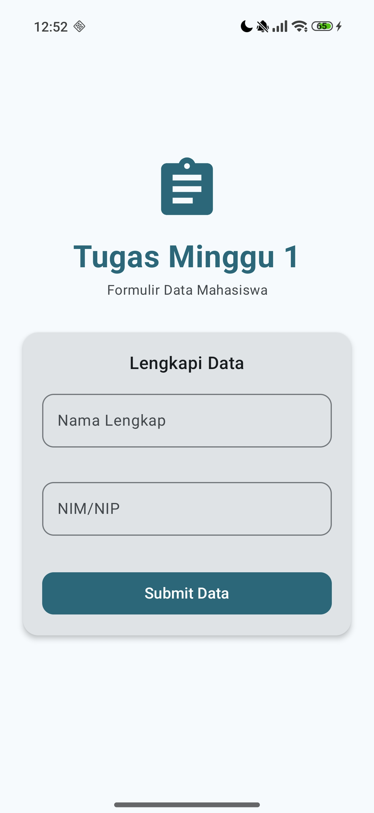
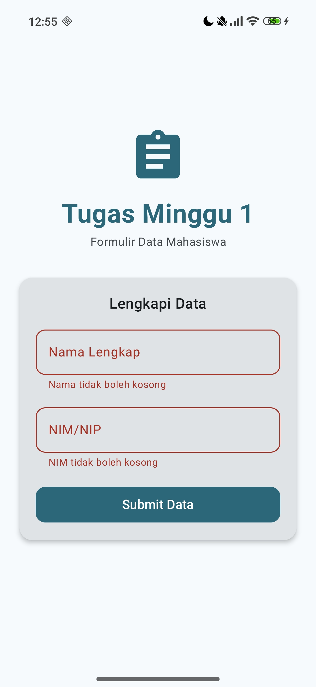
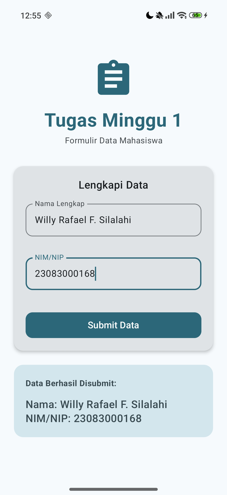

# 📱 Hello World — Pemrograman Mobile Android
## Tugas Minggu 1 | Semester 6

---

## 👤 Profil Mahasiswa
- **Nama:** Willy Rafael  
- **NIM:** [Masukkan NIM Anda di sini]  
- **Matakuliah:** Pemrograman Mobile  
- **Instansi:** [Masukkan Nama Universitas]

---

## 📝 Ringkasan Project
Aplikasi ini merupakan tugas pertama dalam mata kuliah **Pemrograman Mobile Android**. Project ini adalah aplikasi Android modern berbasis **Jetpack Compose** yang mengimplementasikan form input sederhana untuk data mahasiswa (Nama dan NIM/NIP). 

Fokus utama project ini adalah mempelajari dasar-dasar UI deklaratif, State Management menggunakan `remember` & `mutableStateOf`, serta validasi input secara real-time.

---

## ✨ Fitur Utama
- **Input Nama Lengkap**: Validasi tidak boleh kosong.
- **Input NIM/NIP**: Validasi hanya angka dan tidak boleh kosong.
- **Validasi Visual**: Field akan berubah menjadi warna merah dan menampilkan pesan error jika input tidak valid saat menekan tombol submit.
- **Feedback Toast**: Menampilkan pesan peringatan jika data belum lengkap.
- **Preview Data**: Menampilkan hasil inputan dengan animasi `AnimatedVisibility` setelah berhasil disubmit.

---

## 📸 Screenshots & Penjelasan

| Fitur | Screenshot | Penjelasan |
|-------|------------|------------|
| **Form Utama** |  | Tampilan awal aplikasi dengan header icon dan dua field input. |
| **Validasi Error** |  | Tampilan saat user menekan submit namun data kosong/salah (Border merah & pesan error). |
| **Hasil Submit** |  | Tampilan kartu hasil di bagian bawah setelah tombol submit ditekan dengan data valid. |

> *Catatan: Silakan masukkan file gambar di folder `screenshots/` agar muncul di tabel atas.*

---

## 🚀 Cara Menjalankan

### Prasyarat
- Android Studio Hedgehog (2023.1.1) atau lebih baru
- JDK 11+
- Android SDK API 35 (download via SDK Manager)

### Langkah Clone & Run
1. **Clone Project**
   ```bash
   git clone https://github.com/willyrafaelfs/Pemrograman-Mobile-Hello-World.git
   ```
2. **Buka di Android Studio**
   - Pilih **File → Open**
   - Arahkan ke folder hasil clone `HelloWorldAndroid`
3. **Tunggu Gradle sync** selesai.
4. **Jalankan Aplikasi**
   - Hubungkan HP atau gunakan Emulator (Pixel 6 Pro, API 34 direkomendasikan).
   - Klik tombol ▶️ **Run** (Shift + F10).

---

## 🗂 Struktur File
```
HelloWorldAndroid/
├── app/
│   ├── src/main/
│   │   ├── java/com/example/helloworld/
│   │   │   ├── MainActivity.kt              ← Entry point aplikasi
│   │   │   └── ui/
│   │   │       ├── GreetingScreen.kt        ← UI utama (Logic & Form)
│   │   │       └── theme/                   ← Konfigurasi Material3
│   │   ├── res/                             ← Resource (Strings, Icons)
│   │   └── AndroidManifest.xml              ← Manifest aplikasi
│   └── build.gradle.kts                     ← Konfigurasi module
└── build.gradle.kts                         ← Konfigurasi project
```

---

## 📚 Konsep yang Dipelajari

1. **Jetpack Compose**: UI Framework modern Android.
2. **State Management**: Penggunaan `remember` dan `mutableStateOf` untuk membuat UI reaktif.
3. **Material Design 3**: Implementasi `Card`, `Button`, dan `OutlinedTextField` dengan tema M3.
4. **Validation Logic**: Menggunakan parameter `isError` untuk memberikan feedback visual pada user.

---

## 🔗 Referensi
- [Android Developers](https://developer.android.com)
- [Jetpack Compose Docs](https://developer.android.com/jetpack/compose)
- [Material Design 3](https://m3.material.io)
